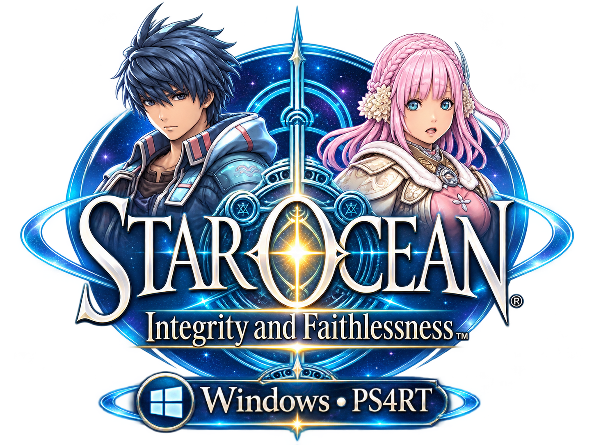
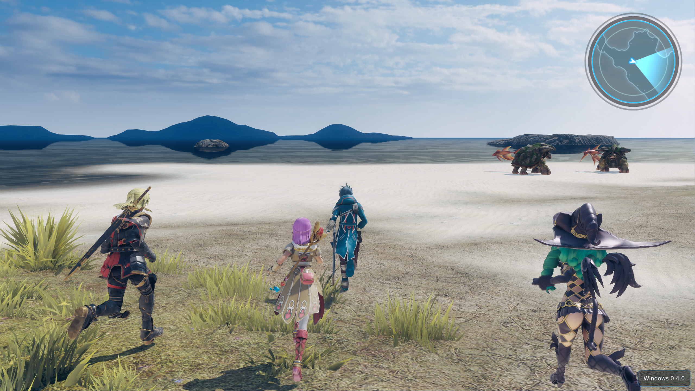

> [!IMPORTANT]
> The Windows version is experimental and still requires extensive testing, particularly by playing through the entire game and verifying its compatibility with a wider range of drivers and hardware. <br>
> Tested with a `Ryzen 9 9950X3D2` CPU with `Radeon RX 9070 XT` GPU running Windows 11 x64 and `Intel i5 7th Gen` CPU with `Nvidia GTX 1050` GPU running Windows 10 x64 (laptop)

# Star Ocean 5 — experimental Windows port


<p align="center">
<a href="https://github.com/Hoverbike51/Star-Ocean-Integrity-and-Faithlessness-PS4RT/releases" rel="nofollow"></a>
<a href="https://github.com/HekamiAeon/Star-Ocean-Integrity-and-Faithlessness-PS4RT/releases" rel="nofollow"></a>
</p>


Version **0.4.0**, for **Windows 10/11 x64**. This branch adapts the game-specific PS4RT
compatibility runtime for Star Ocean: Integrity and Faithlessness (PS4).
It is experimental and has not been validated across a complete playthrough or every PC.

No PS4 game data or firmware is included. Supply your own supported, decrypted game files.
CUSA03219 is the tested PS4 edition. CUSA03246, CUSA01722 and CUSA03567 are recognized
but marked as untested; unrelated titles and PS3 editions are rejected.

## Guides and changes

- [Illustrated launcher guide](docs/LAUNCHER_GUIDE.md): setup, saves, video, input, updates and diagnostics.
- [Illustrated in-game menu guide](docs/IN_GAME_MENU_GUIDE.md): the five tabs, live settings and preset limits.
- [Complete Windows changelog](CHANGELOG.md): current changes, earlier development stages and known limits.

## Playing



For a player package, extract the entire folder and double-click **Star Ocean 5 Launcher.exe**.
The root executable starts the real launcher in `bin/`. Keep the complete folder together;
all application DLLs and internal executables are in `bin/`. Assets and player data remain outside it.
Follow `README-Windows.txt`, included in the player package.

Players do not need to install Python, MSYS2, a Linux subsystem, PowerShell or .NET.
A Vulkan 1.3-capable graphics driver and a supported x86-64 CPU are required.
The launcher checks the environment and selects the game directory or imports a supported PKG.
PKG import uses the independent native **PkgExtractor.exe**. It needs a known creation
passcode; the launcher supports the standard all-zero passcode. See [format limits](docs/LAUNCHER_GUIDE.md#pkg-import).

The Windows launcher provides game/save management, input mapping, video settings, diagnostics,
optional performance capture and a native GitHub updater. Console diagnostics remain English;
the launcher supports 12 interface languages.

Graphics settings can also be opened in game with **Insert** or **L2 + R3 click**.
The launcher offers a Target monitor selector when multiple displays are connected, with
remembered display identity and automatic fallback if that monitor is disconnected.
Aspect ratio filters output choices by All, 4:3, 16:9, 16:10, 21:9 or 32:9; unavailable
families are omitted. Windowed/borderless outputs fit the physical monitor bounds, while
exclusive fullscreen choices also require an exact Windows display mode. The runtime
independently validates the selected monitor and output. See the supported catalog and
limits in [window presentation](docs/LAUNCHER_GUIDE.md#video).
The default game scene input stays at 1080p. Experimental rendering presets can request
different scene inputs with FSR 3.1 or FSR 4 v07; unsupported scene passes are refused and
safe rendering is restored. See [current test limits](docs/IN_GAME_MENU_GUIDE.md#experimental-presets).
This does not claim native 4K scene rendering. The launcher initially uses 84% of the work
area, capped at 1580 x 940, with scrolling for long settings pages.
Anisotropic filtering changes require a game restart.
In windowed mode, **Image fitting** selects Original (fit with bars) or Stretch to window.
Stretch affects final presentation, including the HUD; it does not change scene resolution.
The selected output resolution sets the initial client size; mouse resizing remains available.
Ultrawide windows use bars or stretching; a native ultrawide field-of-view patch is not included.
See [window presentation and GPU checks](docs/LAUNCHER_GUIDE.md#video) for details.
The experimental renderer has been reported stable in local 4K/FSR 4/16x AF tests and
OBS recording; these observations do not establish compatibility on other hardware.

## Saves and backups

Prepared files and runtime user data live under `out/CUSA03219/`.
Save files use `user/savedata/<user-id>/<title-id>/`; a custom title save directory is supported.
The Game tab's **Automatic save backups** switch controls the runtime's existing
`sceSaveDataUmountWithBackup` mechanism. It controls snapshots at launch and when the game requests backup after supported saves.
Both use the same runtime backup engine.

Backups use `user/savedata-backups/<user-id>/<title-id>/<save-slot>/backup-.../`,
including when saves use a custom directory. Each completed snapshot contains `data/` and
optional `sce_sys/` metadata. **Open backups** opens the detected edition's backup directory.
Switch changes apply on the next game launch. Disabling backups preserves normal save/load.
Legacy `save-backups` copies are left untouched, but the launcher no longer creates them.

The optional native performance probe is disabled by default in a fresh player installation.
Enable it only for a diagnostic session; reports stay local and are excluded from packages.
Enable **Performance capture tools** in Advanced to show the two controls in Logs & diagnostics.
Enabling the tools alone does not start a recording.

## Building from source on Windows

These instructions apply to the source checkout, not to a player package.
Install the MSYS2 CLANG64 dependencies listed in `packaging/windows/README.md`.
The project uses **CMake + Ninja + clang/MinGW-w64**, because the PS4 guest boundary needs
System V ABI support and GNU assembly. MSVC is not supported for that boundary.

From a terminal in the checkout:

```powershell
.\build-windows.cmd
& '.\dist\ps4rt-star-ocean-5-windows-x64-v0.4.0-latest\Star Ocean 5 Launcher.exe'
```

The CMD build creates a separate, clean player folder without a ZIP by default.
The explicit form remains available:

```powershell
.\build-windows.cmd -PlayerFolder
```

The folder is created under `dist/ps4rt-star-ocean-5-windows-x64-v0.4.0-latest/`.
The name is read from `VERSION`; no user-specific absolute path is stored in the build scripts.
Keep that entire folder for playing; source files and build intermediates stay in the checkout.
The root launcher is a small native bootstrap, with no application DLLs at the root.
If an earlier player folder contains saves/settings/cache, move or rename it before rebuilding;
packaging refuses to overwrite player data. For developer output only, run
`./build-windows.ps1 -PlayerFolder:$false` in PowerShell.
Only an approved release workflow should create and publish the distributable ZIP.

Developer tests use `build-windows.cmd -Test`. Python is a developer test/reference tool only.
The build detects relocated CMake caches so a copied source checkout can be rebuilt elsewhere.

## Updates and project credits

The launcher queries published Windows player releases from the Hoverbike51 fork.
A Git tag or GitHub source archive is not an installable player update.
See [Native Windows updates](docs/LAUNCHER_GUIDE.md#updates) for package verification and recovery.
No update should replace game data, settings, saves, shader caches or external mods.

The original PS4RT project, adapted shadPS4 renderer and third-party components retain their
licenses and attribution. See [Upstream credits](docs/UPSTREAM_CREDITS.md) and the included
license files. The Windows work does not claim ownership of the game or its assets.
