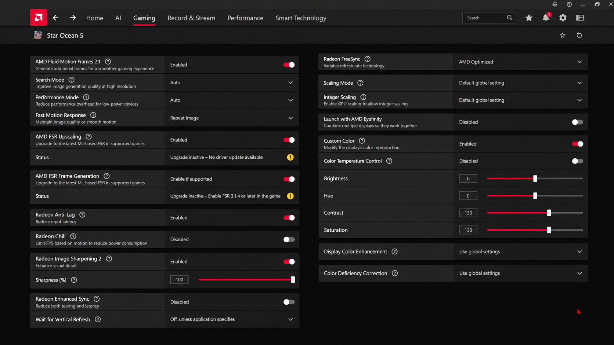

# AMD FSR SDK 2.4 Vulkan integration

## Selecting the provider

Choose **AMD FSR (SDK 2.4)** under launcher Video or the in-game Image tab.
The existing FSR 3.1, FSR 4 v07 and DLSS choices keep their own implementations.
The new provider does not replace source-v07 models or require new trained model files.

The launcher checks the selected GPU policy and installed components. The runtime then
queries AMD's Vulkan API for a compatible implementation and validates context creation
and dispatch. The performance readout reports the actual active provider after successful
initialization. SDK version and reconstruction version are different: the SDK 2.4 package
used here reports FSR 4.1.2 on the development RX 9070 XT. Other devices/drivers can select
a different supported implementation or reject the provider.

Native (100%), Quality, Balanced, Performance and Ultra Performance request scene input
sizes through the existing preset system. Original 1080p remains subject to output-size
checks. Outputs include 4:3, 16:10, 16:9, 21:9 and 32:9; the selected scene projection and
device limits still apply. Reconstruction does not replace the game's original HUD textures.

The existing FSR 3.1 default GPU policy also gates this choice. The lower-tier override
can relax that recommendation but cannot bypass missing Vulkan features or the SDK's
compatibility checks. A rejected provider falls back to the admitted FSR 3.1 path, or
disabled reconstruction, and logs the reason. Check the active-provider readout.

## Distribution and build integrity

Provider files live under `gpu/third_party/amd-fsr-sdk24/`. The packaged application loads
from the explicit application-root path `gpu/assets/amd-fsr-sdk24/`. This path is accepted
by the updater shipped in v1.0.1. Existing/developer `bin/amd-fsr-sdk24/` or
`out/amd-fsr-sdk24/` layouts remain supported. The loader never searches the working
directory or PATH. Missing optional provider DLLs do not prevent application startup.

The signed AMD Vulkan loader/upscaler DLLs are distributed unchanged, together with their
app-local Microsoft Visual C++ x64 runtime DLLs. No separate Microsoft runtime installation
is needed for this provider. Existing system GPU driver requirements still apply.

CMake and `scripts/verify-amd-fsr-sdk.ps1` verify SHA-256 hashes against `binaries.json`.
The normal Windows build and packaging scripts copy the provider folder. Packaging includes
the AMD and Microsoft redistribution notices and an inventory of the shipped DLL versions
and hashes. Keep the provider directory and notices together when distributing the build.

Upstream reference: [AMD FSR SDK](https://gpuopen.com/amd-fsr-sdk/).
This change adds upscaling through Vulkan. It does not add frame generation, XeSS or a
DirectX renderer, and it does not change the existing DLSS compatibility gate.

## Verification and remaining gameplay checks

The isolated GPU test initializes the real official provider and checks 120 output/preset/input-format combinations (240 dispatches):
eight output sizes across five aspect-ratio families (including 3440 x 1440 and 3840 x 2160), with five input presets at each size and three resource configurations. These cover float-color depth, native D32 depth, native D32/stencil depth, reversed depth, HDR scene color and 8-bit SDR color.
It reads back all output pixels and rejects non-finite values or a black center sample. Each combination includes a reset
frame followed by temporal continuation without a CPU queue wait. Missing DLLs and invalid
input dimensions are rejected before valid dispatch.
Settings persistence and unavailable-provider fallback are checked separately.

The official SDK creates image views from the supplied Vulkan images. The integration supplies actual resource formats, depth/stencil usage and matching barrier aspects, rather than declaring every input as a color image. HDR and SDR paths use separate context flags; changing between them recreates the context. Unsupported formats are rejected before dispatch and use the existing fallback. Input formats and color space are logged when a context is created.

