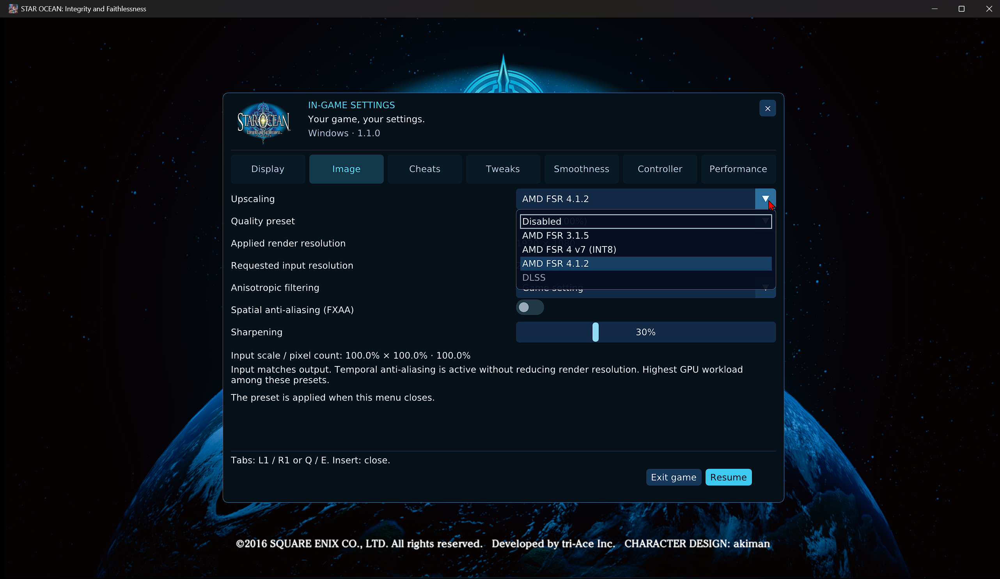
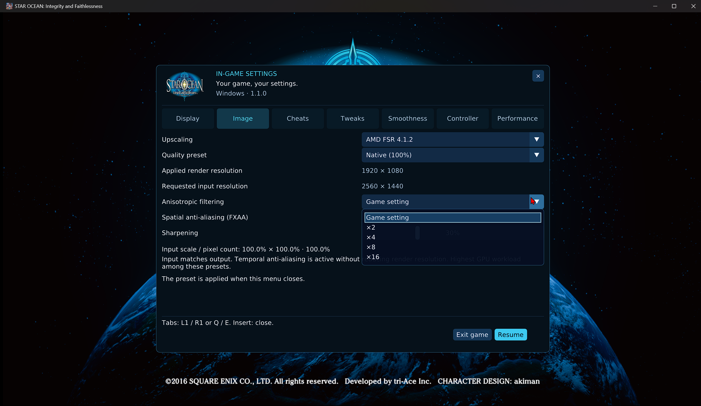
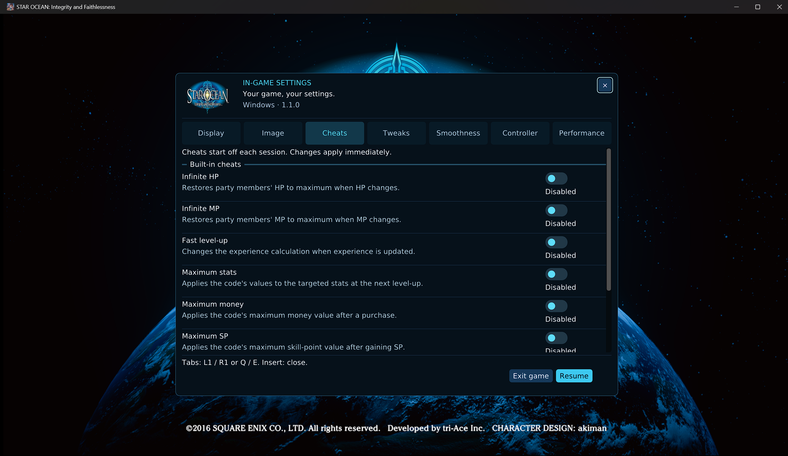
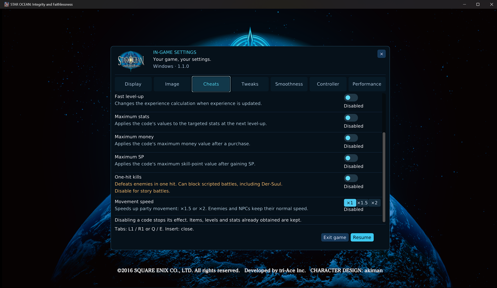
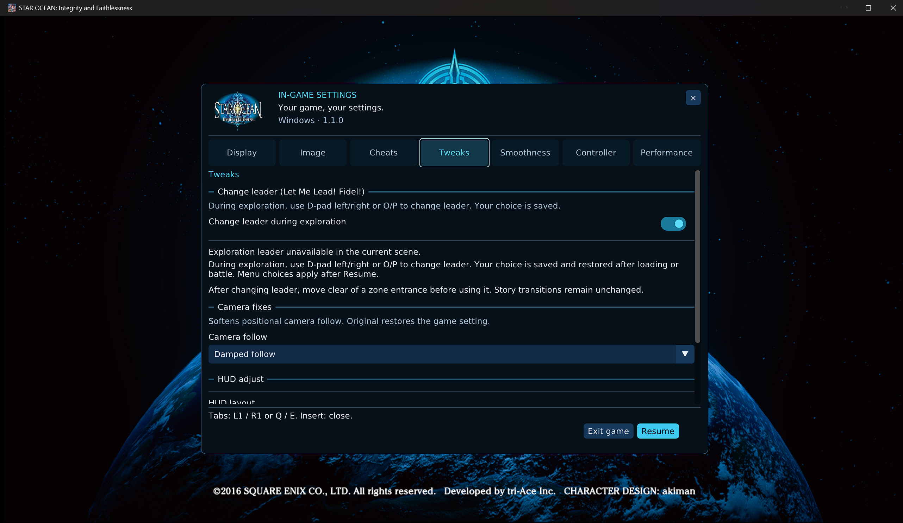
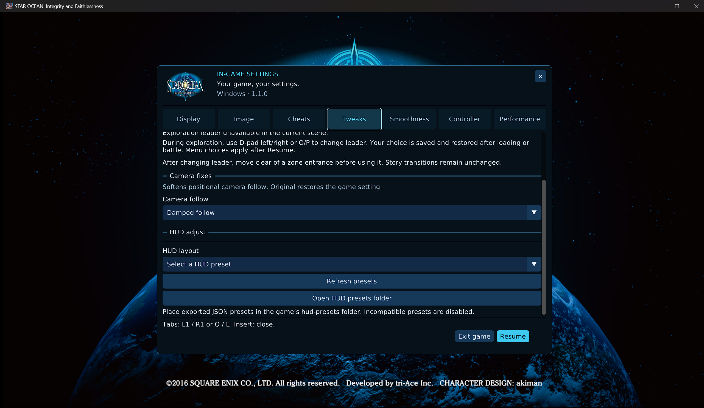
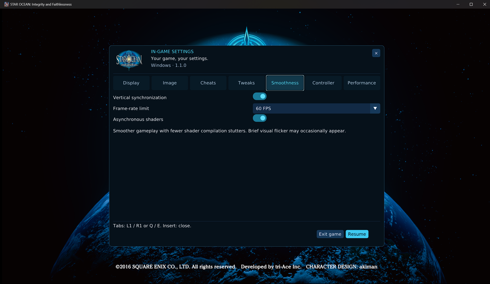
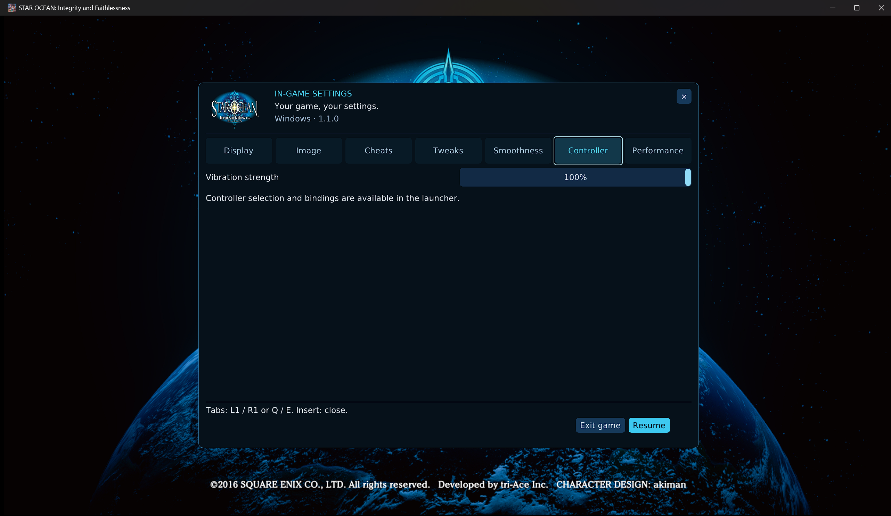
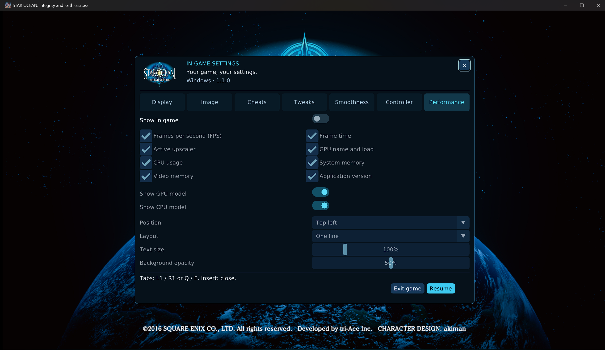

# Star Ocean 5 In-game Menu Guide

**Windows 10/11 x64 · Version 1.1.1**

🟦 **DISPLAY** · 🟩 **IMAGE** · 🟨 **TWEAKS** · 🟥 **DIAGNOSTICS**

[README](../README.md) · [Launcher guide](LAUNCHER_GUIDE.md) · [Changelog](../CHANGELOG.md)

The custom Cockpit menu changes supported runtime options without opening the game's
original settings menus. It uses the launcher's language at game startup. Screenshots
show version 1.1.0 examples; selected values are not defaults, and pending values may
differ from the currently applied render state.

> [!TIP]
> Open with **Insert** or **L2 + R3**. Select a tab, change a setting, then use **Resume**.
> Scroll inside the page when additional settings extend below the visible area.

## Contents

- [Open, navigate and close](#open-navigate-and-close)
- [Display](#display)
- [Image](#image)
- [Upscaling](#upscaling)
- [Manual internal resolution](#manual-internal-resolution)
- [The presets](#the-presets)
- [Anisotropic filtering](#anisotropic-filtering)
- [Spatial anti-aliasing](#spatial-anti-aliasing)
- [Sharpening](#sharpening)
- [Cheats](#cheats)
- [Tweaks](#tweaks)
- [Camera fixes](#camera-fixes)
- [HUD adjustment](#hud-adjustment)
- [Smoothness](#smoothness)
- [Controller](#controller)
- [Performance](#performance)
- [When settings take effect](#when-settings-take-effect)
- [Exit the game](#exit-the-game)

## Open, navigate and close

| Action | Keyboard / mouse | Controller |
| --- | --- | --- |
| Open the menu | Press **Insert**. | Hold **L2** and click the right stick (**R3**); use LT + right-stick click on an Xbox-style pad. |
| Choose a tab | Click it, or use **Q / E**. | Use **L1 / R1** (LB / RB). |
| Navigate controls | Click the control, or use keyboard navigation. | Use the D-pad/stick and the controller navigation controls. |
| Confirm | Click or use the focused control's confirm key. | Cross / A. |
| Back or cancel | Use the control's cancel action; Escape cancels the exit confirmation. | Circle / B. |
| Return to the game | Select **Resume**, the upper-right **X**, or press **Insert** again. | Select Resume, go back from the menu, or use the opening shortcut again. |

The menu takes its interface language from the launcher when the game starts. Changing the
launcher language while a session is already running does not reload that session's menu language.
Settings are saved when the menu closes normally. When a setting requires restart, saving it
does not mean it has changed the current game session.

## Display

| Setting | Use it to | Application |
| --- | --- | --- |
| Display mode | Choose Windowed, Borderless or Fullscreen. | Live, subject to display checks. |
| Aspect ratio | Filter verified output sizes. | Filter is live; a different custom 3D projection requires restart. |
| Output resolution | Select a supported presentation size for the target monitor. | Live within the session's projection constraints. |
| Image fitting | Preserve proportions or stretch the window presentation. | Live; available in Windowed mode. |

*Figure 1 — Display: verified output choices and a proportions preview.*

**Display mode** selects Windowed, Borderless or Fullscreen. **Aspect ratio** filters the
available output sizes, and **Output resolution** selects a verified size for the current
target monitor. Choose the target monitor and GPU in the launcher before starting the game;
the custom menu does not provide live GPU migration.

Only supported catalog entries verified against the selected monitor are offered. Changing
mode or aspect filter can select a different valid output if the previous one is unavailable.
Borderless keeps the desktop display mode. Windowed output sets the initial client dimensions;
manual mouse resizing remains possible. Exclusive fullscreen requires a verified display mode.

**Image fitting** is available in Windowed mode:

| Choice | Result |
| --- | --- |
| Original | Preserve the session projection and fit the image without stretching. Original menus and movies retain their own proportions. |
| Stretch to window | Fill the window, stretching the complete presentation, including the HUD. |

The preview illustrates fitting; it does not prove a new internal render size.
On the guarded `CUSA03219` / `APP_VER 01.00` executable, the source supports real
`4:3`, `16:10`, `21:9` and `32:9` scene projections. The narrow-format HUD and loading-mask updates have been accepted in local testing.
Choose the ratio before launch; the in-game output list retains
that session's projection ratio. Foreground menus and prerendered videos keep their
proportions. Supported menu backgrounds can fill the output independently through a HUD preset.
Other executables use the original `16:9` projection. Internal input dimensions are
shown separately in Image.

> [!IMPORTANT]
> **Output resolution**, **3D input resolution** and **HUD layout** are separate settings.
> Stretch to window can distort the complete image. To reposition a HUD without stretching
> it, use a compatible JSON layout in **Tweaks > HUD adjust**.

## Image

*Figure 2 — Image: applied and requested input sizes can differ until a change is accepted.*

### Upscaling

| Choice | Path used | Compatibility checks |
| --- | --- | --- |
| Disabled | No temporal reconstruction; manual internal resolution. | Render dimensions and device limits. |
| AMD FSR 3.1.5 | Integrated FSR 3.1.5. | GPU policy, Vulkan features and scene inputs. |
| AMD FSR 4 v7 (INT8) | Supplied v7 INT8 model/shader bundle. | GPU features, assets and supported dimensions. |
| AMD FSR 4.1.2 | Official Vulkan provider integrated through SDK 2.4. | Provider components, compatible driver/GPU and valid resources. |
| DLSS | Optional NVIDIA bridge/runtime. | Compatible NVIDIA GPU, installed components and valid inputs. |

*Figure 3 — Separate provider choices. A grey entry is unavailable for the current GPU,
installed components or output mode.*

The official AMD provider and v7 INT8 models are separate paths. The runtime queries the
official provider's effective implementation and reports it after initialization; see
[SDK integration](AMD_FSR_SDK.md). NVIDIA hardware does not select DLSS automatically.
Compatible FSR choices remain separate from DLSS. XeSS and frame generation are not implemented.

FSR 3.1 availability can be restricted by the project's conservative default GPU policy.
For a technically capable device, use **Advanced > Force FSR 3.1 availability** in the
launcher and confirm the warning, then start a new game session. This cannot bypass missing
Vulkan features or force FSR 4. Outputs below the supported temporal-reconstruction size
disable the temporal choices, even on otherwise compatible hardware.

> [!IMPORTANT]
> If validation fails, a safe path is restored and the reason is logged. Read the **active
> provider** and **Applied render resolution** after a change; the selected label alone
> does not prove that reconstruction was dispatched successfully.

### Manual internal resolution

With **Upscaling > Disabled**, **Render resolution** offers supported `720p`, `1080p`,
`1440p` and `2160p` scene sizes. Width follows the session's supported projection ratio.
The runtime checks its raster/device limits before accepting a choice. With FSR or DLSS
active, the quality preset controls the requested input instead.

Increasing internal resolution can improve 3D detail but does not replace low-resolution
HUD textures. Output size still controls presentation. Inspect **Applied render resolution**
to verify the input actually in use rather than assuming a selected 2160p target is active.

### The presets

A preset requests the scene input size supplied to reconstruction. It does not select a
bundle of texture, shadow, geometry and lighting quality settings.

| Preset | Requested input relative to output | Requested input at 3840 x 2160 output | Purpose |
| --- | --- | --- | --- |
| Original 1080p | 1080 input lines; width follows the supported projection | 1920 x 1080 | Preserve the original input height; the reconstruction ratio follows the output size. |
| Native (100%) | 100% per axis | 3840 x 2160 | Temporal anti-aliasing without reducing the requested scene size. |
| Quality | About 66.7% per axis | 2560 x 1440 | Favor fine detail with a moderate reduction in input pixel count. |
| Balanced | About 58.8% per axis | Approximately 2258 x 1270 | Intermediate detail/workload balance. |
| Performance | 50% per axis | 1920 x 1080 | Lower input workload and more reconstruction. |
| Ultra Performance | About 33.3% per axis | 1280 x 720 | Lowest requested input; detail loss and reconstruction artifacts are more likely. |

Dimensions are rounded to even pixels. When the guarded aspect projection is active,
presets use that projection's full output area; Original 1080p keeps 1080 input lines
with the corresponding width. Otherwise they use the fitted `16:9` content area.
**Native (100%)** sits above Quality in input detail/workload; it was named explicitly to
avoid confusing native-resolution anti-aliasing with a lower-resolution upscaling preset.

**Original 1080p and Performance request the same size at 4K output**, but they are not the
same rule: Original remains fixed when the output changes, whereas Performance tracks half
the output width and height. Smaller outputs can require a different input choice; Original
1080p is not offered when it would exceed the fitted output dimensions.

Select a preset, then close the menu to attempt application. No game restart is intended for
an accepted live preset change. The menu explains the selected preset and shows per-axis
input scale and total input pixel percentage; that percentage is not a predicted FPS gain.

**Variable scene resolution is experimental and can be refused in real gameplay.** A choice
being visible does not mean every game pass supports it. Earlier builds refused some presets in tested scenes. Availability is now checked
against current inputs and device limits; it is not a universal gameplay-quality guarantee.

The renderer requires a valid scaled scene color and depth before using the requested input.
If those conditions are not met, it restores a safe preset and displays a notice rather than
passing incompatible resources to reconstruction. For an initial compatibility baseline, use **Original 1080p** when available, then
compare another preset on the same route. At 4K output, Performance requests
the same 1080p input and can avoid the dimension change that triggers a refusal.

Read the two status rows separately:

- **Requested input resolution** is the selected target, including a pending change.
- **Applied render resolution** reports the input observed by the runtime; it can still show the last
  dispatched size while a change is pending or after a safe fallback.

In Figure 2, **Applied render resolution** is 1920 x 1080 while the requested input is
2560 x 1440. The status therefore shows a pending or unapplied size change. Selecting a
larger requested value alone does
not establish that the game is rendering at that resolution. After a refusal, export the
launcher diagnostic report; `Scene preset refused` and `Scene preset inputs` identify the
request and the color/depth validation state. Do not repeatedly retry a refused mode as a
way to force it through the guard.

### Anisotropic filtering

*Figure 4 — Texture filtering is independent of the reconstruction provider and preset.*

Choose **Game setting**, **x2**, **x4**, **x8** or **x16** to control eligible textured surfaces
viewed at an angle. This is separate from anti-aliasing and sharpening.

A change is saved for the **next game launch**. **Filtering for this session** shows the
startup setting actually used now. If it differs from the choice above, exit and restart
the game to apply the new choice. No hot sampler replacement is claimed.

### Spatial anti-aliasing

**Spatial anti-aliasing (FXAA)** enables the runtime's existing SDR edge filter.
It can be changed live and is saved independently of the reconstruction provider.
It is off by default and affects the final image, including the HUD; it can soften
small text and fine texture detail. HDR bypasses this SDR filter. FXAA does not replace
temporal reconstruction or increase the resolution of source textures.

### Sharpening

The **Sharpening** slider adjusts edge contrast from 0% to 100%; zero disables sharpening.
It changes live. It cannot recover all detail missing from a low-resolution texture or
replace a 4K UI texture pack. Figure 2 shows 30%, which is an example rather than a
required value. Compare fine details in motion; excessive sharpening can emphasize aliasing.

> [!TIP]
> **A repeatable image-quality comparison:** keep the scene, camera angle and output size
> unchanged. Change one provider/preset at a time, close the menu, check the applied size,
> and compare both a still view and movement. Test sharpening last. FXAA can smooth the
> final image but also soften text; it is not a fix for invalid color/depth inputs.

## Cheats

> [!WARNING]
> Save progress before experimenting. One-hit kills can block scripted battles; disable
> it for story encounters. Disabling a code does not undo levels, stats or items already gained.

*Figure 5 — Cheats: independent HP/MP switches and event-triggered progression codes.*

Enable access in the launcher's Cheats tab first. Codes require the matching title,
APP_VER and original executable bytes; all start off. Infinite HP and MP are independent.
Progression/currency codes trigger at the event in their description. Movement speed has
x1 (off), x1.5 and x2 positions. Disable one-hit kills for scripted story battles, which
can otherwise be blocked. Previously gained values remain after disabling a code.
External cheat-profile imports and the unsafe mass-inventory hook are not available.

*Figure 6 — Scroll to reach one-hit kills and the three-position movement-speed control.*

| Type | How to use it |
| --- | --- |
| HP / MP | Enable the required code independently; restoration occurs when the corresponding value changes. |
| Experience / stats / money / SP | Enable, then perform the event described on the card. They are not immediate inventory grants. |
| One-hit kills | Toggle for suitable encounters; turn off before scripted story battles. |
| Movement speed | Choose ×1 to disable, ×1.5 or ×2 to accelerate party movement. |

For all eight descriptions, see the [launcher catalogue](LAUNCHER_GUIDE.md#cheats).
**Ready** in the launcher means the code passed availability checks; **Enabled** in this
menu means you activated its effect for this session.

## Tweaks

*Figure 7 — Tweaks: exploration leader controls and Camera fixes.*

**Change leader (Let Me Lead! Fidel!)** enables exploration cycling with O/P or D-pad
left/right when the current party/game state permits it. Native transition guards reduce
repeated entrance triggering. Cycling is blocked while **L2 or R2** is held. Changes
selected inside the menu take effect after **Resume** when the game state allows them.

> [!WARNING]
> **Fidel follower issue remains open.** In some locations Fidel can stop following a
> different exploration leader. Restore Fidel as leader if this happens. The latest update
> does not claim to solve every location-dependent follower failure.

### Camera fixes

Use **Tweaks > Camera fixes > Camera follow** to choose how the camera follows the
character's position:

| Mode | Behaviour |
| --- | --- |
| Original | Restores the game's original positional follow setting. |
| Light damping | Adds a gentler positional response than Original, with less immediate following. |
| Damped follow | Uses stronger positional damping to soften abrupt follow movements further. |

The selected mode applies during play when the prepared executable passes the patch's
compatibility checks. If those checks fail, the control is disabled. You can also select
the startup mode in the launcher's **Tweaks** tab. The setting is saved on normal close;
choose **Original** to restore the original follow response.

These modes adjust the native positional follow filter. They preserve manual camera
rotation, field of view and the game's collision handling. They do not provide a free
camera, lock camera height or fully remove vertical movement over uneven terrain. Comfort
remains subjective; compare the modes on the same route and choose the most comfortable.

### HUD adjustment

*Figure 8 — Camera follow, HUD layout selection, library refresh and preset-folder access.*

**HUD layout** selects compatible JSON files from the local preset library. Supported
formats include `4:3`, `16:10`, `16:9`, `21:9` and `32:9`. A preset changes mapped
placement, scale and visibility; it does not install replacement textures.

1. Select **Open HUD presets folder** and place the compatible `.json` file there.
2. Select **Refresh presets**.
3. Choose the layout. Read the applying/queued/error status if one appears.
4. Resume and inspect the relevant mapped HUD in the game.

The launcher provides the same library for startup selection. An incompatible preset is
disabled. Source JSON files remain intact. Choose **Original** to reset HUD placement;
without an active custom layout, the original HUD is retained.

| Element | Layout policy |
| --- | --- |
| Mapped gameplay HUD | Preset placement, scale and visibility apply, including at 16:9. |
| Foreground menu panels, text and icons | Keep their proportions; extending a backdrop does not stretch them. |
| Supported menu backgrounds | Explicit JSON **Original / Extended** sizing takes priority over automatic sizing. Extended fills both width and height. |
| Pause controls | Separately mapped, including the Options/Back prompt. |
| Loading blackout | Always fills the complete output in both axes, including 4:3 and 16:10. |
| Prerendered video | Retains its original proportions. |
| Subtitles / unidentified elements | Mapping is incomplete; do not assume every group can be moved or hidden. |

Schema-4 background overrides are supported; older schema-1/2/3 presets remain readable.
If a layout does not apply, keep the preset and export the launcher diagnostic with the
game ID, aspect ratio and group affected. Do not stretch the entire window to compensate
for a single unmapped UI element.

## Smoothness

*Figure 9 — Smoothness: presentation timing and asynchronous shader compilation.*

| Control | Effect and tradeoff |
| --- | --- |
| Vertical synchronization | Requests synchronized presentation to reduce tearing. Actual pacing depends on the display and driver. |
| Frame-rate limit | 30 FPS, 60 FPS or Unlimited presentation cap. This does not guarantee a sustained frame rate or change every game-engine timing rule. |
| Asynchronous shaders | Compile new shader/pipeline work without blocking every affected draw. This reduces first-use stalls, but brief missing effects or flicker can occur. |

With async disabled, a new shader can briefly stall gameplay while it compiles. Keep the
shader cache between normal sessions. If a scene is black or effects are persistently
missing, compare the same route with async disabled and collect diagnostics. FSR cannot
remove CPU-side waits or guarantee 60 FPS when another part of the runtime is limiting play.

## Controller

*Figure 10 — Controller: live vibration strength.*

Use **Vibration strength** to adjust the runtime's controller rumble level. Input-device
selection and keyboard bindings remain in the launcher; this page is not a remapping editor. DS4,
DualSense and Xbox-style pads use SDL's standardized mapping. Connect/disconnect/reconnect
is supported during a session. Keyboard/mouse remapping and layout profiles are configured
in the launcher for the next launch. Avoid duplicate external remapping devices.

## Performance

*Figure 11 — Performance: visibility, model labels, position and overlay appearance.*

Enable **Show in game** to display the overlay. The individual controls remain selected but
are disabled while the master switch is off, as illustrated in the screenshot.

| Metric | Meaning |
| --- | --- |
| Frames per second (FPS) | Measured presentation rate. |
| Frame time | Time per presented frame; 60 FPS corresponds to about 16.7 ms. |
| Active upscaler | The provider actually in use, useful after a fallback. |
| GPU name and load | Model of the Vulkan adapter used by the runtime, plus its available utilization reading. |
| CPU usage | Game-process CPU utilization normalized across logical processors; the CPU model is read separately. A low aggregate value can hide a busy thread or synchronization wait. |
| System memory | Game-process working set and installed physical-memory capacity, not total Windows RAM usage. |
| Video memory | Available GPU-memory usage/budget readouts. |
| Application version | The Windows build version. |

**Show GPU model** and **Show CPU model** are independent. Turn either off to show the
short GPU / CPU label without hiding its utilization reading.

| Appearance control | Choices |
| --- | --- |
| Position | Top left / top center / top right / bottom left / bottom center / bottom right. |
| Layout | One line / one item per line / Technical. |
| Text size | 50%–300%. |
| Background opacity | 0%–100%. |

**Active upscaler** reports the effective provider and applied preset. With reconstruction
off it shows **Native · NO PRESET**. DLSS **Native (100%)** is reported as **DLAA**;
other DLSS modes retain their Super Resolution preset identity.
These appearance and visibility changes are live. The separate title-screen Windows version
label does not depend on enabling the performance overlay and is hidden outside its recognized title screen.

This overlay does **not** enable the performance recorder. Recording is controlled separately
by the launcher's [capture tools](LAUNCHER_GUIDE.md#logs-and-diagnostics).

### Technical overlay and diagnostic capture (1.1.1)

**Technical** is the detailed overlay layout. It adds a frame-time history, the busiest
Windows thread, logical-processor count and sampler timing. Hardware/thread usage updates
about twice per second; frame-time history updates with presented frames. Model visibility,
position, size and opacity remain independently adjustable.

| Reading | Meaning |
| --- | --- |
| Process CPU | Game-process usage averaged across logical processors. A low value does not exclude a busy thread. |
| Busiest thread | CPU usage relative to one logical processor, plus its Windows ID/name when available. |
| Sample age / interval / collection time | Freshness, measurement interval and collection cost. Unavailable values display as N/A. |
| Frame history | Recent presented frame times; a peak indicates uneven presentation, not its root cause. |

For an issue report, enable capture through the launcher and reproduce the problem on the
affected PC. Version 1.1.1 adds presentation-stage timings, runtime wait reasons, requested
versus effective reconstruction and bounded contexts for frames over 100 ms. See the
[capture procedure and interpretation table](LAUNCHER_GUIDE.md#performance-probe-111).
The overlay alone does not start recording. Existing screenshots above show 1.1.0;
the interface pictured remains applicable to the unchanged controls.

## When settings take effect

| Setting | Application |
| --- | --- |
| Display mode, verified output size, aspect filter and image fitting | Live, subject to display-mode validation. |
| Supported reconstruction provider and sharpening | Live, subject to runtime checks and fallback. |
| Quality preset / manual internal resolution | Attempted on menu closure; subject to scene and resource validation. |
| Compatible HUD JSON layout | Queued/applied by the runtime; inspect the apply status and resume. |
| Custom 3D projection ratio | Select before launch; restart the game to change it. |
| Anisotropic filtering | Next game launch; the current-session readout stays separate. |
| VSync, frame-rate cap and asynchronous shader setting | Live runtime controls. |
| Vibration strength and performance-overlay controls | Live. |
| GPU, target monitor, keyboard bindings and the menu's interface language | Configure in the launcher; start a new game session. |

Display, accepted image presets, sharpening, overlay and supported Tweaks can change during
play. Device selection, launcher language and startup input mappings need a new game
session. Anisotropic filtering explicitly requires restart. A saved request is not proof
that an incompatible mode was accepted: check the actual readout and diagnostic.

After a normal game exit, the launcher imports the runtime settings it tracks, including
anisotropy, so the next launch does not overwrite the menu's saved selection with a stale value.

## Exit the game

> [!IMPORTANT]
> **Save in the game first.** Saving menu preferences is independent from saving story progress.

**Resume**, the menu's **X** and **Insert** close settings and return control to the game.
They do not save game progress.

Select **Exit game** to open the confirmation dialog. Cancel returns to the menu; confirming
requests game shutdown and returns you to the launcher when the process finishes. Save
progress using the game's own save system first. For a performance investigation, prefer
this exit path over terminating the process in Task Manager so reports can be finalized.
