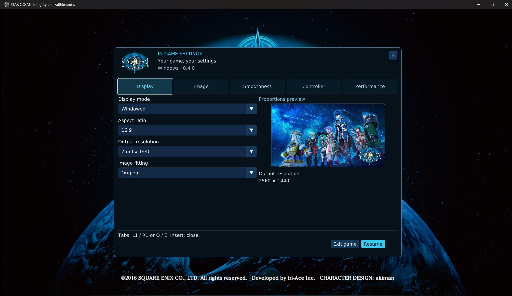
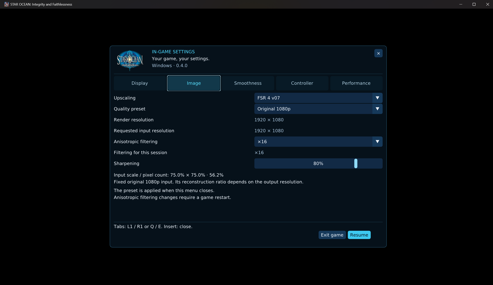
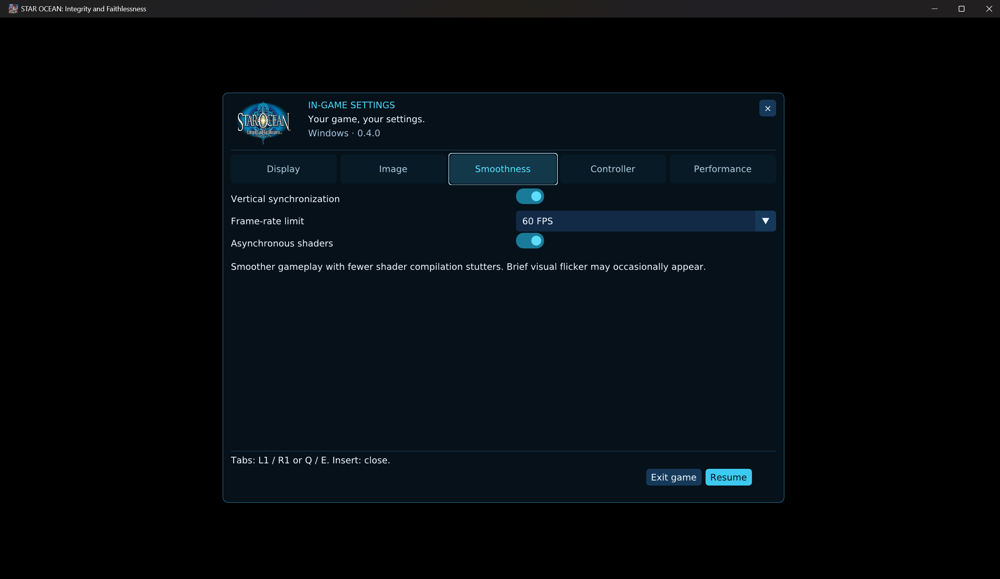
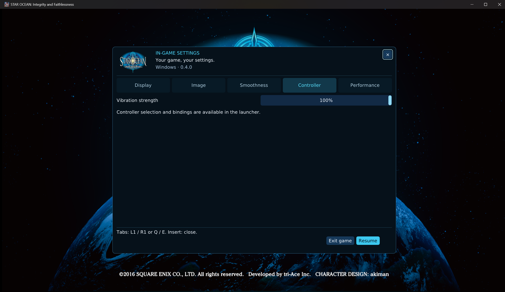
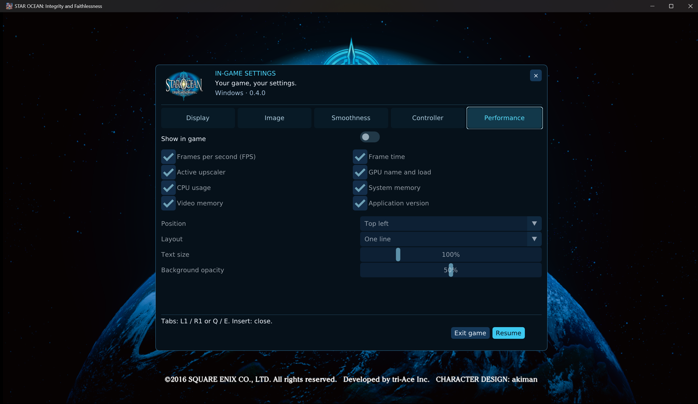

# Star Ocean 5 In-game Menu Guide

**Windows 10/11 x64 · Experimental version 0.4.0**

The in-game Cockpit changes supported runtime settings while Star Ocean 5 is running.
It is separate from the game's original PS4 menus. This guide follows the five English
tabs in the supplied screenshots; selected values are examples, not recommended defaults.

[Project README](../README.md) · [Launcher guide](LAUNCHER_GUIDE.md) · [Changelog](../CHANGELOG.md)

## Contents

- [Open, navigate and close](#open-navigate-and-close)
- [Display](#display)
- [Image](#image)
- [Smoothness](#smoothness)
- [Controller](#controller)
- [Performance](#performance)
- [When settings take effect](#when-settings-take-effect)
- [Exit the game](#exit-the-game)

## Open, navigate and close

| Action | Keyboard / mouse | Controller |
| --- | --- | --- |
| Open the menu | Press **Insert**. | Hold **L2** and click the right stick (**R3**); use LT + right-stick click on an Xbox-style pad. |
| Choose a tab | Click it, or use **Q / E**. | Use **L1 / R1** (LB / RB). |
| Navigate controls | Click the control, or use keyboard navigation. | Use the D-pad/stick and the controller navigation controls. |
| Confirm | Click or use the focused control's confirm key. | Cross / A. |
| Back or cancel | Use the control's cancel action; Escape cancels the exit confirmation. | Circle / B. |
| Return to the game | Select **Resume**, the upper-right **X**, or press **Insert** again. | Select Resume, go back from the menu, or use the opening shortcut again. |

The menu takes its interface language from the launcher when the game starts. Changing the
launcher language while a session is already running does not reload that session's menu language.
Settings are saved when the menu closes normally. When a setting requires restart, saving it
does not mean it has changed the current game session.

## Display

**Display mode** selects Windowed, Borderless or Fullscreen. **Aspect ratio** filters the
available output sizes, and **Output resolution** selects a verified size for the current
target monitor. Choose the target monitor and GPU in the launcher before starting the game;
the custom menu does not provide live GPU migration.

Only supported catalog entries verified against the selected monitor are offered. Changing
mode or aspect filter can select a different valid output if the previous one is unavailable.
Borderless keeps the desktop display mode. Windowed output sets the initial client dimensions;
manual mouse resizing remains possible. Exclusive fullscreen requires a verified display mode.

**Image fitting** is available in Windowed mode:

| Choice | Result |
| --- | --- |
| Original | Preserve the 16:9 image and use bars when proportions differ. |
| Stretch to window | Fill the window, stretching the complete presentation, including the HUD. |

The preview illustrates fitting; it does not prove a new internal render size. A 21:9 or
32:9 output is not a native ultrawide camera/HUD patch. Output dimensions describe the final
presentation. Internal input dimensions are shown separately in Image.

## Image

### Upscaling

Available reconstruction choices are **Disabled**, **FSR 3.1** and **FSR 4 v07**. Hardware,
Vulkan-feature, asset and output checks determine which choices appear. FSR 4 uses the
supplied v07 model path; this menu does not expose DLSS or XeSS.

FSR 3.1 may be hidden by the project's conservative default GPU policy. A technically
capable device can be enabled through the launcher's **Advanced > Force FSR 3.1 availability**
confirmation, followed by a new game launch. This cannot bypass missing hardware features
or force FSR 4. If reconstruction fails validation, the runtime restores a safe path and
records the reason. Always check the actual active-provider readout after a fallback.

### Quality presets

A preset requests the scene input size supplied to reconstruction. It does not select a
bundle of texture, shadow, geometry and lighting quality settings.

| Preset | Requested input relative to output | Requested input at 3840 x 2160 output | Purpose |
| --- | --- | --- | --- |
| Original 1080p | Fixed 1920 x 1080 | 1920 x 1080 | Preserve the original game input; the reconstruction ratio follows the output size. |
| Native (100%) | 100% per axis | 3840 x 2160 | Temporal anti-aliasing without reducing the requested scene size. |
| Quality | About 66.7% per axis | 2560 x 1440 | Favor fine detail with a moderate reduction in input pixel count. |
| Balanced | About 58.8% per axis | 2258 x 1270 | Intermediate detail/workload balance. |
| Performance | 50% per axis | 1920 x 1080 | Lower input workload and more reconstruction. |
| Ultra Performance | About 33.3% per axis | 1280 x 720 | Lowest requested input; detail loss and reconstruction artifacts are more likely. |

Dimensions are rounded to even pixels. On non-16:9 outputs, ratios apply to the fitted
16:9 content area rather than automatically expanding the game's camera field of view.
**Native (100%)** sits above Quality in input detail/workload; it was named explicitly to
avoid confusing native-resolution anti-aliasing with a lower-resolution upscaling preset.

**Original 1080p and Performance request the same size at 4K output**, but they are not the
same rule: Original remains fixed when the output changes, whereas Performance tracks half
the output width and height. Smaller outputs can require a different input choice; Original
1080p is not offered when it would exceed the fitted output dimensions.

Select a preset, then close the menu to attempt application. No game restart is intended for
an accepted live preset change. The menu explains the selected preset and shows per-axis
input scale and total input pixel percentage; that percentage is not a predicted FPS gain.

### Experimental presets

**Variable scene resolution is experimental and can be refused in real gameplay.** A choice
being visible does not mean every game pass supports it. Native (100%), Quality, Balanced
and Ultra Performance have been reported refused in tested scenes; they are not presented
here as universally validated modes.

The renderer requires a valid scaled scene color and depth before using the requested input.
If those conditions are not met, it restores a safe preset and displays a notice rather than
passing incompatible resources to reconstruction. For ordinary play, keep **Original 1080p**
unless another mode has been checked in your own scene. At 4K output, Performance requests
the same 1080p input and can avoid the dimension change that triggers a refusal.

Read the two status rows separately:

- **Requested input resolution** is the selected target, including a pending change.
- **Render resolution** reports the input observed by the runtime; it can still show the last
  dispatched size while a change is pending or after a safe fallback.

The screenshot has both rows at 1920 x 1080. Selecting a larger requested value alone does
not establish that the game is rendering at that resolution. After a refusal, export the
launcher diagnostic report; `Scene preset refused` and `Scene preset inputs` identify the
request and the color/depth validation state. Do not repeatedly retry a refused mode as a
way to force it through the guard.

### Anisotropic filtering

Choose **Game setting**, **x2**, **x4**, **x8** or **x16** to control eligible textured surfaces
viewed at an angle. This is separate from anti-aliasing and sharpening.

A change is saved for the **next game launch**. **Filtering for this session** shows the
startup setting actually used now. If it differs from the choice above, exit and restart
the game to apply the new choice. No hot sampler replacement is claimed.

### Sharpening

The **Sharpening** slider adjusts edge contrast from 0% to 100%; zero disables sharpening.
It changes live. It cannot recover all detail missing from a low-resolution texture or
replace a 4K UI texture pack. The screenshot's 80% is an example, not a required setting.

## Smoothness

| Control | Effect and tradeoff |
| --- | --- |
| Vertical synchronization | Requests synchronized presentation to reduce tearing. Actual pacing depends on the display and driver. |
| Frame-rate limit | 30 FPS, 60 FPS or Unlimited presentation cap. This does not guarantee a sustained frame rate or change every game-engine timing rule. |
| Asynchronous shaders | Compile new shader/pipeline work without blocking every affected draw. This reduces first-use stalls, but brief missing effects or flicker can occur. |

With async disabled, a new shader can briefly stall gameplay while it compiles. Keep the
shader cache between normal sessions. If a scene is black or effects are persistently
missing, compare the same route with async disabled and collect diagnostics. FSR cannot
remove CPU-side waits or guarantee 60 FPS when another part of the runtime is limiting play.

## Controller

**Vibration strength** scales the game's standard two-motor rumble from 0% to 100%.
100% preserves the requested strength; zero suppresses subsequent vibration commands.
The setting is live, but it does not generate a test pulse or make the game request rumble
where no vibration event exists. Device/driver/connection support is still required.

This is standard controller vibration, not DualSense adaptive-trigger or audio-haptics support.
Use the launcher's **Controls** tab to choose keyboard mode or edit keyboard bindings; this
in-game tab does not contain a full controller/keyboard mapping editor.

## Performance

Enable **Show in game** to display the overlay. The individual controls remain selected but
are disabled while the master switch is off, as illustrated in the screenshot.

| Metric | Meaning |
| --- | --- |
| Frames per second (FPS) | Measured presentation rate. |
| Frame time | Time per presented frame; 60 FPS corresponds to about 16.7 ms. |
| Active upscaler | The provider actually in use, useful after a fallback. |
| GPU name and load | Selected graphics adapter and the available utilization reading. |
| CPU usage | A utilization summary; a low aggregate percentage does not rule out a busy thread or synchronization bottleneck. |
| System memory | Runtime memory usage and system-memory capacity readouts. |
| Video memory | Available GPU-memory usage/budget readouts. |
| Application version | The Windows build version. |

Choose one of four corners with **Position**, a single line or one item per line with
**Layout**, text size from 50% to 300%, and background opacity from 0% to 100%.
These appearance and visibility changes are live. The separate title-screen Windows version
label does not depend on enabling the performance overlay and is hidden outside its recognized title screen.

This overlay does **not** enable the performance recorder. Recording is controlled separately
by the launcher's [capture tools](LAUNCHER_GUIDE.md#logs-and-diagnostics).

## When settings take effect

| Setting | Application |
| --- | --- |
| Display mode, verified output size, aspect filter and image fitting | Live, subject to display-mode validation. |
| Supported reconstruction provider and sharpening | Live, subject to runtime checks and fallback. |
| Quality preset | Attempted on menu closure; can be refused safely. |
| Anisotropic filtering | Next game launch; the current-session readout stays separate. |
| VSync, frame-rate cap and asynchronous shader setting | Live runtime controls. |
| Vibration strength and performance-overlay controls | Live. |
| GPU, target monitor, keyboard bindings and the menu's interface language | Configure in the launcher; start a new game session. |

After a normal game exit, the launcher imports the runtime settings it tracks, including
anisotropy, so the next launch does not overwrite the menu's saved selection with a stale value.

## Exit the game

**Resume**, the menu's **X** and **Insert** close settings and return control to the game.
They do not save game progress.

Select **Exit game** to open the confirmation dialog. Cancel returns to the menu; confirming
requests game shutdown and returns you to the launcher when the process finishes. Save
progress using the game's own save system first. For a performance investigation, prefer
this exit path over terminating the process in Task Manager so reports can be finalized.
