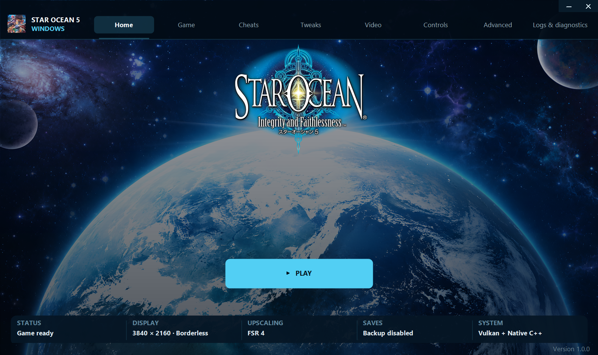
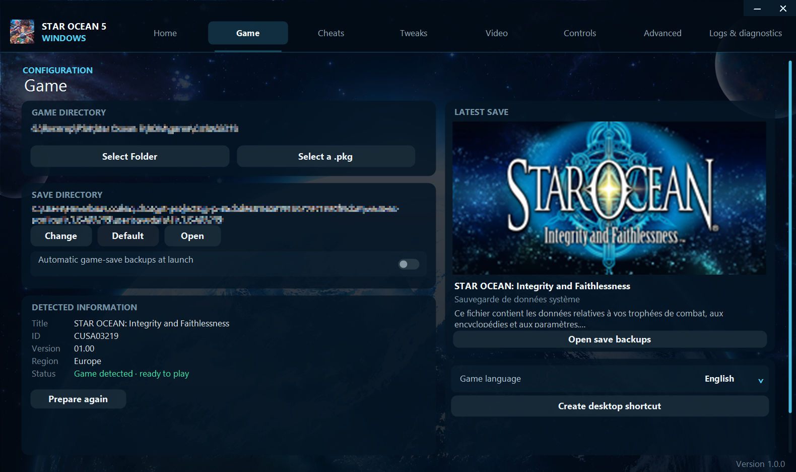
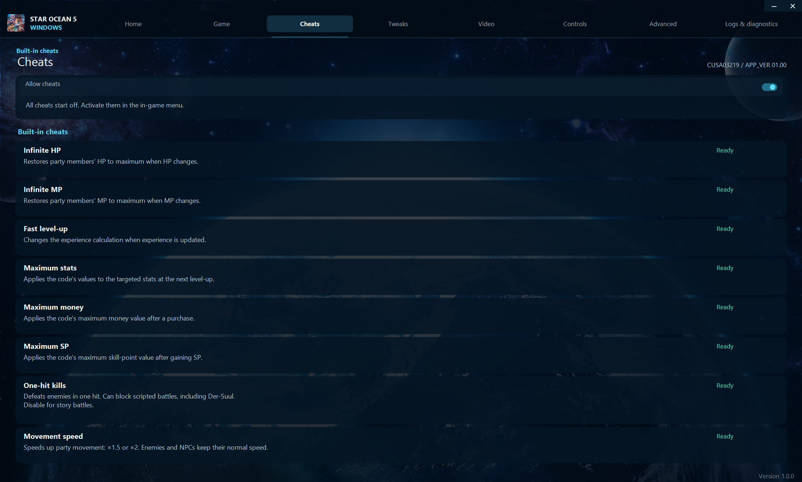
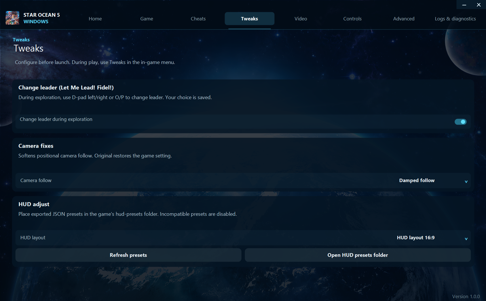
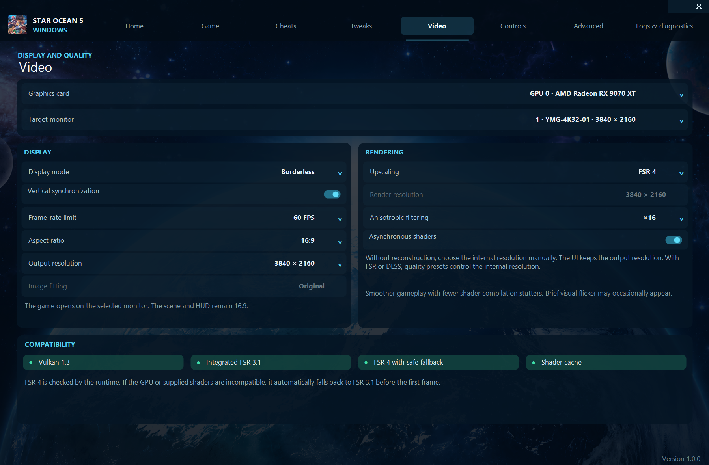
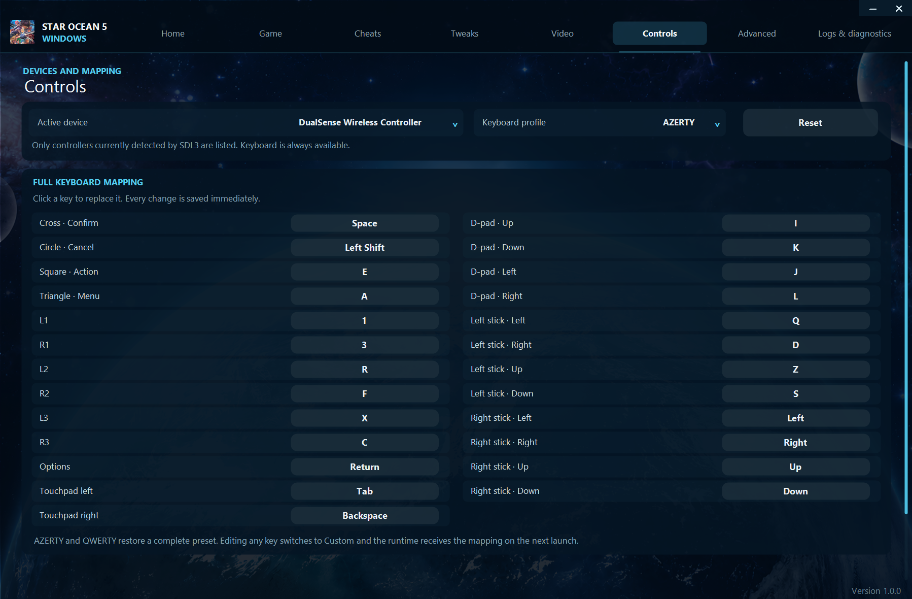
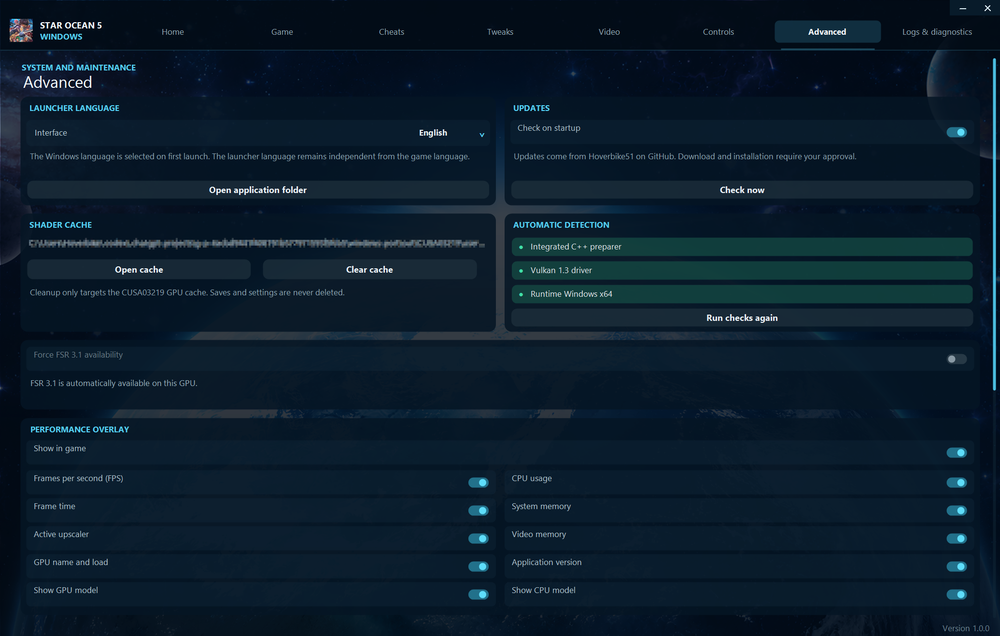
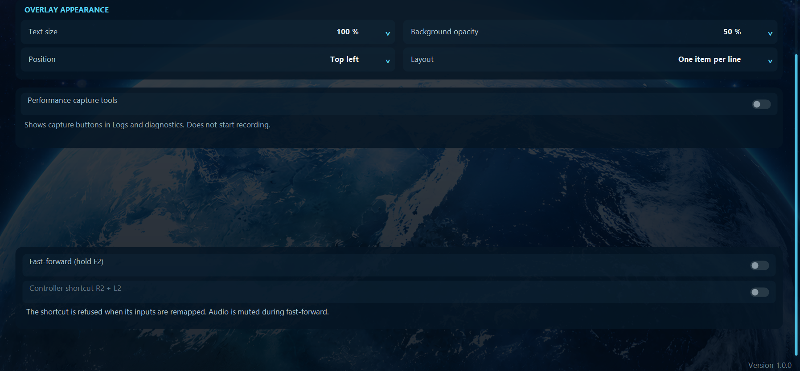
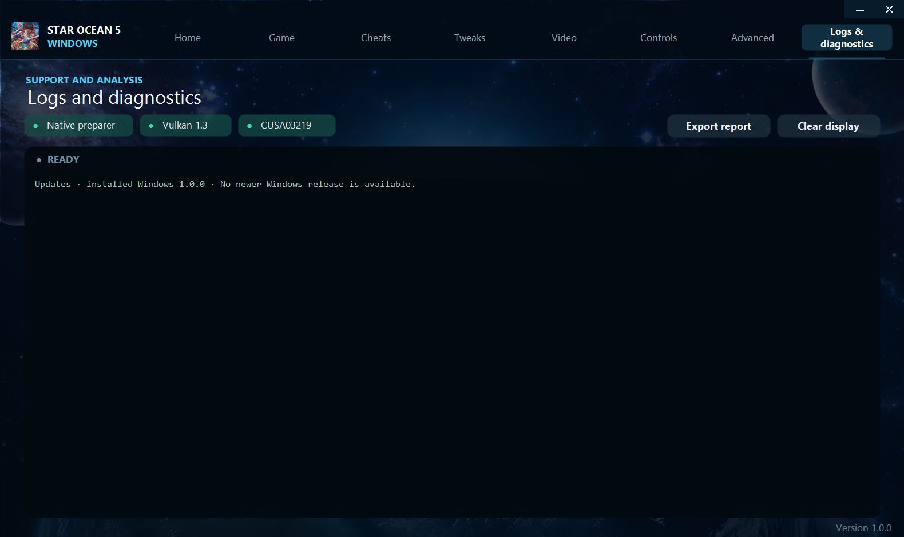

# Star Ocean 5 Launcher Guide

**Windows 10/11 x64 · source version 1.0.0**

The Cockpit launcher prepares your own PS4 game files, manages settings and starts the
Windows runtime. Screenshot paths and values are examples, not installation defaults.
Building sources and publishing a tested release are separate steps.

[README](../README.md) · [In-game menu](IN_GAME_MENU_GUIDE.md) · [Changelog](../CHANGELOG.md)

## Contents

- [First launch](#first-launch)
- [Home](#home)
- [Game](#game)
- [Cheats](#cheats)
- [Tweaks](#tweaks)
- [Video](#video)
- [Controls](#controls)
- [Advanced](#advanced)
- [Logs and diagnostics](#logs-and-diagnostics)
- [Known issues and troubleshooting](#known-issues-and-troubleshooting)

## First launch

1. Extract the complete player package into a writable folder.
2. Start **Star Ocean 5 Launcher.exe** at the package root. It opens the real launcher in `bin`.
3. Open **Game**, then select your extracted game folder or import a supported `.pkg`.
4. Wait for game validation and preparation. Check the detected Title ID and status.
5. Review **Video** and **Controls**, return to **Home**, and select **Play**.

Keep `bin`, the asset folders, `VERSION` and the documentation together. Do not move just the
root executable to another folder. Players do not need Python, MSYS2, PowerShell or .NET;
building the source requires the toolchain described in the [Windows build instructions](https://github.com/Hoverbike51/Star-Ocean-Integrity-and-Faithlessness-PS4RT/blob/windows-native/packaging/windows/README.md).
A compatible x86-64 CPU and a working Vulkan 1.3 graphics driver are required. Game files
and firmware are not included.

## Home

The main page presents the game logo, **Play** and a bottom status dock. Select and prepare
a valid game before playing. The dock summarizes the current configuration; it does not
guarantee compatibility or a particular frame rate. The launcher minimizes when starting
the game. Use its caption buttons to minimize or close; closing asks for confirmation.

## Game

### Select an extracted folder

Select **Select Folder**, then choose the actual game directory containing `eboot.bin`,
`sce_sys` and `sce_module`, rather than a parent directory or an individual executable.
The launcher remembers the selection. **Prepare game** creates the local working files;
**Prepare again** repeats preparation when a game is already configured. Preparation does
not modify the original game extraction.

Detected information shows the title, Title ID, game version, region and readiness after
validation. The game version here is the PS4 content version, not the Windows launcher version.

| Indicator | Meaning |
| --- | --- |
| Green — `CUSA03219` | Tested European PS4 edition. |
| Orange — `CUSA03246`, `CUSA01722` or `CUSA03567` | Recognized PS4 edition; accepted with an untested-edition warning. |
| Red — unrelated or unsupported ID | Launch is refused. PS3 editions are not supported. |

Acceptance of another region does not establish compatibility with every update, save or
language for that edition. The ID badge is shown only after game validation.

### PKG import

1. Select **Select a .pkg** and choose your locally owned PS4 package.
2. Review the import dialog and choose the parent extraction directory. The launcher remembers it.
3. Confirm extraction and watch the expanded-byte progress. Detection alone does not mean extraction is finished.
4. Wait for extraction, content validation and preparation to complete before selecting **Play**.

A completed extraction is stored in a folder named after the detected Title ID, for example
`<chosen parent>\CUSA03219`. An existing destination is not silently replaced. Canceling
an import cleans up the partial import created by that operation.

Import uses the independent native `bin/PkgExtractor.exe`. Its supported PS4 PFS/PFSC path
needs the package creation passcode; the launcher uses the standard all-zero passcode.
Unknown passcodes, unsupported structures and invalid packages are reported in diagnostics.
Retail-license/key recovery and downloading PSN content are not provided. Selecting a PKG
does not make the runtime execute the compressed archive directly.

### Save directory and backups

**Save directory** displays the current Windows path. **Change** selects a custom live-save
location, **Default** restores the standard location, and **Open** opens the current one.
Changing the setting selects a location; it is not a promise to convert or migrate another
edition's saves. Stop the game before replacing live save files. The launcher's preview
releases its image files so you can replace saves without closing the launcher.

For a standard installation, paths below are relative to the player folder:

| Data | Location |
| --- | --- |
| Launcher preferences | `out/launcher.ini` |
| Prepared game and runtime settings | `out/CUSA03219/` |
| Live saves | `out/CUSA03219/user/savedata/1/<Title ID>/` |
| Backup snapshots | `out/CUSA03219/user/savedata-backups/1/<Title ID>/<slot>/backup-.../` |

The current working-root name remains `CUSA03219` even for another accepted edition; the
live-save and backup subfolders use the detected Title ID. A custom live-save location
does not relocate the backup root.

**Automatic game-save backups at launch** enables the shared native backup engine for
pre-launch snapshots and supported backup requests made by the game after saving.
Disabling it preserves normal save/load and existing backups. **Open save backups** opens
the detected edition's backup directory. Completed snapshots contain `data` and, when
available, `sce_sys` metadata; they are not ordinary files to drop directly into a live-save slot.

Completed backups are held read-only against replacement/deletion while the launcher is
running. Close the launcher before manually replacing a backup. This protection does not
lock live saves or replace a separate copy kept outside the application folder.

### Latest save, language and shortcut

The latest-save card displays the available image and details from save metadata, such as
play time, location and difficulty. It is a preview, not a save-slot selector or a command
to load that slot in the game. Returning to **Game** refreshes the metadata.

**Game language** offers the languages configured for the detected edition. It remains
independent of the launcher language. **Create desktop shortcut** creates a shortcut with
the game icon and a launch argument; keep the installed player folder in place afterward.

## Cheats

The native catalogue is checked against Title ID, APP_VER and original executable bytes.
Enable access here, then apply individual codes in the in-game Cheats tab. All begin off.
There are eight native codes: infinite HP, infinite MP, fast level-up, maximum stats,
maximum money, maximum SP, one-hit kills and movement speed.

Movement speed has three positions: `x1` (off), `x1.5` and `x2`. Money/SP/stat codes take effect
at the event named in their description. Disabling a code does not remove values already
obtained. One-hit kills can block scripted battles; disable it for story battles.
External cheat-profile import and the unsafe mass-inventory code are no longer offered.

## Tweaks

Optional native adjustments are grouped here:

- **Change leader (Let Me Lead! Fidel!):** allows exploration leader cycling with O/P or
  D-pad left/right when supported by the current party/game state. Transition guards limit
  repeated entrance triggers. It is separate from the game's combat character switching.
- **Camera fixes:** choose the original or available damped follow behaviour. These modes
  reduce abrupt following; they are not a free camera or a configurable FOV.
- **HUD adjustment:** choose a compatible JSON layout or return to the original HUD.
  **Open HUD presets folder** provides access to the preset library. Source JSON files
  are preserved. The original layout remains active when no custom layout is selected.

## Video

Choose the GPU and target monitor before starting a game. Output sizes/aspect filters are
restricted to the selected display's supported catalogue/modes. Fullscreen requires a
verified display mode; Borderless retains the desktop mode. A selected Windowed size sets
the initial client dimensions, and manual mouse resizing remains possible.

### Display controls

| Control | What it changes |
| --- | --- |
| Display mode | Windowed, Borderless or Fullscreen presentation. |
| Vertical synchronization | Requests synchronized presentation to reduce tearing. |
| Frame-rate limit | Sets the presentation cap, normally `30` or `60` FPS in the launcher. A cap does not guarantee that frame rate. |
| Aspect ratio | Filters output choices: `All`, `4:3`, `16:9`, `16:10`, `21:9` or `32:9`, when verified choices exist. |
| Output resolution | Selects the presentation dimensions from the project's supported catalog and the verified monitor modes. |
| Image fitting | In Windowed mode, Original preserves proportions with bars; Stretch to window fills the window and can distort the scene an

### Rendering controls

Scene rendering supports native `21:9`/`32:9` widths. This does not automatically reposition
every HUD element: use a compatible HUD layout. Prerendered video retains its original
aspect ratio; game menus retain their centered composition. Image fitting controls final
window presentation and stretching can distort the entire image.

With reconstruction **Disabled**, manual internal scene sizes include `720p`, `1080p`, `1440p`
and `2160p`, subject to runtime/device checks. With FSR/DLSS enabled, its presets own the
input size. Output resolution, internal scene resolution and original UI texture quality
are different things. A higher internal size does not replace source textures.

| Control | What to expect |
| --- | --- |
| Upscaling | Disabled, `FSR 3.1` or `FSR 4 v07`, according to the selected GPU and runtime checks. |
| Render resolution | A status/readout in the launcher. Experimental preset selection is in the in-game Image tab. |
| Anisotropic filtering | Game setting, `x2`, `x4`, `x8` or `x16`. Improves eligible textures viewed at an angle; requires a game restart. |
| Asynchronous shaders | Reduces first-use compilation stalls, with a possible tradeoff of temporary visual omissions or flicker. |d HUD. |

`FSR 3.1`, `FSR 4 v07` and optional `DLSS` availability depends on GPU features/assets and runtime
validation. Unsupported choices are disabled. `DLSS` additionally requires the separate
bridge and `NVIDIA` runtime; `XeSS` and frame generation are not implemented. `FSR` can cost
more than it saves on older hardware. The explicit lower-tier `FSR 3.1` override is under
Advanced and cannot bypass missing hardware capabilities.

Anisotropic filtering affects eligible textures viewed at an angle and requires restart.
Asynchronous shaders reduce compilation stalls but can briefly omit/flicker some rendering.
VSync and frame caps control presentation; they do not guarantee a sustained frame rate.
See [Image](IN_GAME_MENU_GUIDE.md#image) for live presets and sharpening.

## Controls

**Active device** lists SDL-detected controllers and **Keyboard**. DS4, DualSense and
Xbox-style devices use SDL's standardized controls. The runtime automatically handles
controller activity; the displayed name is not an exclusive lock to a particular hardware
ID when several controllers are connected. Choosing Keyboard prevents gamepad input.

**Keyboard profile** provides `AZERTY` and `QWERTY` defaults. To customize a binding:

1. Click its current key button.
2. Press the replacement key, or press **Escape** to cancel capture.
3. Repeat for the other controls and start the next game session.

Changes are saved immediately, switch the profile to **Custom**, and are passed to the
runtime on the next launch. Bindings cover the face buttons, shoulders/triggers, stick
clicks, Options, both touchpad-click sources, D-pad and both stick directions. **Reset**
restores the selected default layout; selecting `AZERTY` or `QWERTY` also replaces the custom set.

The screenshot shows an ``AZERTY`` example. Read the displayed bindings for your chosen profile
instead of assuming those letters are the ``QWERTY`` defaults. This page provides keyboard
remapping; it does not expose a custom gaming-mouse button mapper or arbitrary gamepad
rebinding editor. Controller vibration is adjusted in the [in-game Controller tab](IN_GAME_MENU_GUIDE.md#controller).

## Advanced

### Updates

**Check on startup** enables release checking; **Check now** starts a manual check against
Hoverbike51's GitHub releases. It checks Windows player packages, not the original project's
Linux release version. A numeric Git tag or GitHub source-code ZIP alone is not an installable update.

When an eligible newer package is available, the dialog offers:

- **Download** — download, verify and extract the package, then hand it to the native installer.
- **Open GitHub** — open the release page without installing.
- **No** — dismiss the offer for this session; startup checks may offer it next time.

Close the game before installation. Updates verify the archive size, GitHub SHA-256 digest,
paths, versioned executables and staged startup before replacing program files. Missing
checksums or network errors prevent automatic installation. Source checkouts are not replaced
by the player updater. Equal or older versions are not installed over the current version.

The updater preserves `out`, game files, saves, settings, caches and external mod folders.
Replaced program files and a recovery journal are kept under `out/updates/.../previous`.
A failure attempts rollback and reports the outcome; keep the recovery files until the new
installation has been checked. This does not provide a power-loss recovery guarantee.

### Shader cache and system checks

**Open cache** opens the GPU cache location. **Clear cache** requests confirmation and removes
shader/cache data, preserving saves and settings. Stop the game first. Clearing the cache
is a troubleshooting operation; the next visit to a scene may require shader compilation again.
Keep an existing cache for ordinary play.

**Run checks again** refreshes detection of the native preparer, Vulkan driver and Windows
runtime. These checks cannot certify a complete playthrough or every graphics option.

### Force FSR 3.1 availability

The project uses a conservative default policy based on recognized desktop GPU classes,
with `GTX 1080`, `RX 5700` and `Arc A750` among its reference points. It is not a universal
performance ranking for all newer, mobile or unidentified cards.

If a technically capable GPU is outside that default policy, **Force FSR 3.1 availability**
can expose it after a confirmation about possible performance loss or instability. The
choice is off by default and tied to that GPU. It is unavailable when FSR 3.1 is already
admitted normally, or when required Vulkan features are absent. It cannot force `FSR 4` or
bypass hardware feature checks. Launch the game again after changing it.

### Overlay and capture tools

**Performance overlay** controls the on-screen FPS, frame time, active upscaler, GPU,
CPU, RAM, VRAM and application-version readouts. Appearance controls adjust text size,
background opacity, corner and single-line/multiline layout. The in-game Performance tab
also exposes these options. The overlay does not record a performance report.

**Performance capture tools** is off by default. Enabling it only reveals **Capture next
session** and **Open captures** in Logs and diagnostics; it does not start a recording.
Scroll the Advanced page if the lower controls are outside the window. 

**Acceleration** is off by default. Uses F2 or R2+L2, for fast forwad unskippable cutscene. Any sound will 
be muted durring this process. (Was mainly used to test the game after a cutscene that couldn't be skipped)

## Logs and diagnostics

The badges summarize preparation, Vulkan and the validated game ID. Console messages remain
**English**, regardless of the interface language, so reports can be compared consistently.

- Drag to select console text; use **Ctrl+A** to select all and **Ctrl+C** to copy.
- Use vertical scrolling to revisit earlier output and horizontal scrolling for long lines.
- **Export report** writes a diagnostic text file under `out/logs/`.
- **Clear display** clears the visible retained log; it does not clear saves or shader caches.

To capture a performance investigation:

1. Enable **Advanced > Performance capture tools**.
2. Open **Logs and diagnostics** and enable **Capture next session**.
3. Start the game, reproduce the problem and exit through the in-game **Exit game** command.
4. Use **Open captures** to find the local CSV/JSON reports under
   `out/CUSA03219/user/gpu/performance/`.
5. Turn capture off when you no longer need a diagnostic session.

The two capture buttons are intentionally absent in the screenshot because the tools are
switched off. Reports remain local; nothing is uploaded automatically. A normal menu exit
allows the runtime to finalize its report; an external forced termination can leave partial data.

## Known issues and troubleshooting

| Symptom | First action |
| --- | --- |
| Missing DLL or executable | Extract the complete player folder again; keep the real applications and DLLs in `bin`. |
| Wrong or empty game information | Select the extracted game directory itself and wait for validation. |
| A rendering preset is refused | Return to previous working preset; see the [experimental preset limits](IN_GAME_MENU_GUIDE.md#experimental-presets). Export diagnostics after the refusal. |
| `FSR 4 v07` can show an outdoor/zone-transition bottom-edge line | No fix currently. Turn it off avoids that reported line but loses temporal smoothing. |
| Title screen globe 3D scene | Tied `16:9` aspect ratio to prevent the introductory video from being stretched. |
| Transition zone (`21:9` - `32:9`) | Still revert to the `16:9` aspect ratio as soon as an end-of-zone border indicator is reached and then restore it. |
| FSR is slower on older hardware | Compare with Upscaling disabled, keeping the same scene and output resolution. |
| Saves are not found | Check the displayed save path, Title ID and save-slot folder structure. |
| Backups cannot be replaced | Close the launcher before replacing completed backup snapshots. |
| No downloadable update | A tag is insufficient; a newer compatible Windows player Release asset and its digest are required. |

- Save progress in the game's own save system before using **Exit game**. Closing the custom
settings menu or the launcher is not a command to save game progress.